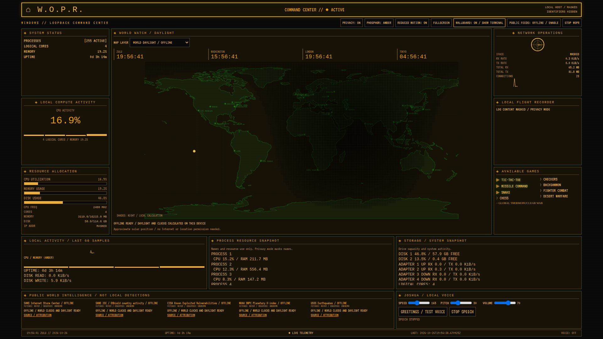
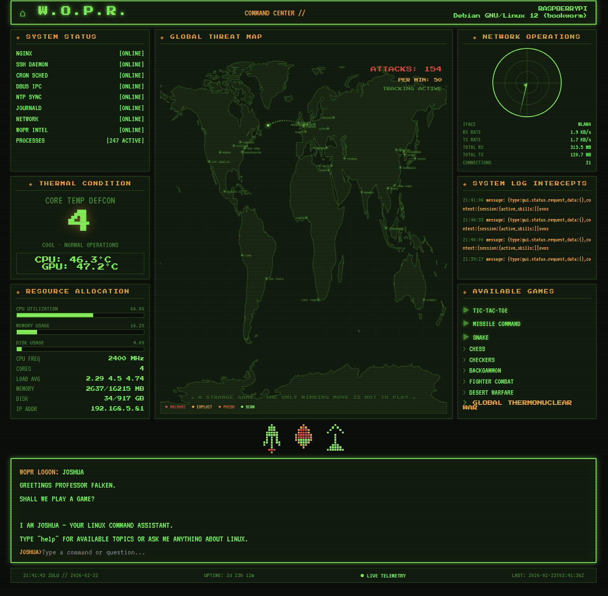

# WOPR Command Center

A *WarGames*-inspired system dashboard for Windows PCs and Raspberry Pi homelabs.
WOPR combines live system telemetry, an offline command reference, robotic
JOSHUA speech, and playable retro games in a CRT-style browser interface.

The project provides two deployment options:

- **Windows:** a local-only command center for a desktop or second screen,
  with a portable packaging workflow and optional public information feeds.
- **Raspberry Pi:** an Nginx-hosted dashboard with a systemd telemetry service,
  local system logs, and optional CGI-based speech.

WOPR is a system viewer and entertainment dashboard, not a security product or
remote administration tool. Its command helper explains commands; it does not
execute them.

## Contents

- [Features](#features)
- [Windows setup](#windows-setup)
- [Raspberry Pi setup](#raspberry-pi-setup)
- [Dashboard data](#dashboard-data)
- [Security and privacy](#security-and-privacy)
- [Development and packaging](#development-and-packaging)
- [Customization](#customization)
- [Credits and licensing](#credits-and-licensing)

## Features

### Shared dashboard

- Live CPU, memory, disk, network, uptime, and service information where supported.
- JOSHUA command-reference terminal with platform-specific examples and movie references.
- Local robotic speech using eSpeak NG, with browser voice controls.
- Tic-Tac-Toe against JOSHUA, Missile Command, and Snake.
- CRT scanlines, phosphor glow, and an embedded VT323 font.
- Offline world clocks and a calculated day/night world map.
- Adaptive panels that show useful local activity when hardware sensors are absent.
- Rolling CPU, memory, and network activity charts.
- Browser-based interface with no cloud AI account required.

### Windows edition

- Local PC telemetry, including per-core CPU load, disk activity, network
  throughput, process summaries, and battery/AC status where available.
- Read-only, best-effort Windows service, Defender, and firewall status.
- PowerShell and Azure CLI reference examples. No Azure account or Azure CLI
  installation is required to use the reference.
- Compact wallboard view, expanded terminal, fullscreen, privacy masking,
  amber/green themes, and low-motion controls.
- Optional public feeds from SANS ISC, CISA, NOAA SWPC, and USGS.
- Observed cyber-activity map with country-level report volumes from SANS
  ISC/DShield, plus a separate earthquake layer.
- Loopback-only runtime that does not require administrator access.

### Raspberry Pi edition

- CPU temperature and temperature-based DEFCON indicators.
- Local journal excerpts and failed SSH login records where accessible.
- Nginx and system service status.
- Linux command-reference terminal.
- Bash-based telemetry collection with no Python, Node.js, or database required
  at runtime.

### Previews



Windows-edition wallboard running offline against the portable runtime on Linux,
with identifiers masked. Windows-native packaging requires separate validation.

### Raspberry Pi WOPR (now with games!)



## Windows setup

### Portable package

The repository includes a Windows x64 build workflow. A downloadable package is
available only after a successful packaging run; a source checkout alone does
not include a prebuilt executable.

1. Open [GitHub Actions](https://github.com/dougrichards13/nginx_WOPR/actions/workflows/windows.yml)
   and select a successful **Windows portable WOPR** run.
2. Download the **WOPR-Windows-x64** artifact. GitHub may require you to sign in.
   Extract the downloaded artifact, then extract `WOPR-Windows-x64.zip` inside it.
3. Open `WOPR.exe` in the extracted `WOPR` folder. Keep `_internal/` and `speech/`
   alongside the executable. Run as a standard user, not as administrator.
4. WOPR opens your browser at a local-only address on an available port.
   Use the voice test or greeting control to enable audio; browsers require a
   user gesture before playback.
5. Enable public feeds only if you want them. Local telemetry, games, and bundled
   speech work offline, along with world clocks and the daylight map. Once the
   cyber feed loads, the map switches to observed activity unless you have already
   chosen another layer. Use **MAP LAYER** to switch between daylight, cyber
   activity, and earthquakes. Select **SHOW TERMINAL** to expand the wallboard.
6. Stop WOPR with the dashboard shutdown control or **Ctrl+C** in its console.
   Closing the browser tab alone does not stop the server.

The portable edition does not require a separate Python installation, Nginx,
Azure CLI, an account, or an inbound firewall rule. It does not create an
automatic startup entry. Native Windows ARM64 packages are not currently built.

Builds are unsigned and may be blocked by Windows SmartScreen or organizational
policy. Follow your organization's approval process; do not disable protections
to run WOPR.

### Run from source

Install [Python 3.11 or later](https://www.python.org/downloads/windows/), download
or clone this repository, and open PowerShell in the project folder:

```powershell
py -3 -m venv .venv
.\.venv\Scripts\python.exe -m pip install -r requirements-windows.txt
.\.venv\Scripts\python.exe windows\wopr.py
```

After creating the environment, you can also use `Launch WOPR.cmd` or
`windows/Launch-WOPR.ps1`. The launchers do not bypass PowerShell execution
policy. The direct Python command does not require environment activation.

Runtime options:

- `--offline`: keep public feeds disabled for the current run.
- `--no-browser`: start without automatically opening a browser tab.
- `--port NUMBER`: use a specific local port instead of selecting one automatically.

Source runs use an installed `espeak-ng` when available; portable builds bundle
their own engine. Unavailable speech does not prevent telemetry or games.

### First-use display

WOPR starts with local telemetry, world clocks, and a daylight map without
requiring an account or API key. CPU activity replaces an unsupported thermal
panel; desktop systems show uptime instead of an absent battery. Missing process
or security probes give way to session and storage information. Network-rate
counters briefly show **SAMPLING** while collecting their initial measurements.
Smaller screens can scroll rather than clipping dashboard panels.

To use the observed cyber map, choose **ENABLE PUBLIC FEEDS** at first launch or
from the toolbar. Its country markers and rankings come from the
[SANS ISC country feed](https://isc.sans.edu/api/country?json), refreshed no more
than hourly during a running session. Hover over a marker to see report, source,
and target counts. The map shows aggregate sensor reports, not individual attack
paths or a second-by-second worldwide stream. Marker locations are representative
country label points; they do not establish attacker identity or nationality.

If a provider is unreachable, WOPR retries automatically. Previously fetched
observations remain visible with their status and retrieval time for the rest of
the session. With no observations available, the daylight map remains usable.
Public feeds are integrated into the Windows runtime; the Pi/Nginx edition uses
the offline daylight map and world clocks.

### Updating and removing Windows WOPR

For a portable installation, stop WOPR and extract the newer package into a
separate folder. For a source checkout, pull the latest code and reinstall
`requirements-windows.txt` using the virtual environment's Python.

To uninstall, stop WOPR and delete its extracted folder. To reset preferences,
also remove `%LOCALAPPDATA%\WOPR\settings.json` and the browser's WOPR site data.
Browser preferences are origin-specific; a different local port may start a new
set of display and voice preferences.

## Raspberry Pi setup

### Requirements

- Raspberry Pi running Raspberry Pi OS or a compatible Debian-based system.
  The original deployment was tested on a Raspberry Pi 5.
- Nginx using the standard `/var/www/html` web root and a compatible site configuration.
- Git to clone the repository.
- Administrator access to install dependencies and configure systemd.

The installer replaces `/var/www/html/index.nginx-debian.html`, installs the
telemetry service, and attempts to configure the speech endpoint in the default
Nginx site. Review `install.sh` and back up an existing site before installing.
Custom Nginx deployments may require manual configuration.

### Install

```bash
sudo apt update
sudo apt install -y git nginx
git clone https://github.com/dougrichards13/nginx_WOPR.git
cd nginx_WOPR
sudo bash install.sh
```

The installer installs `bc` if needed and attempts to install `espeak-ng` and
`fcgiwrap` for speech. If speech dependencies cannot be installed, voice setup
is skipped.

Open `http://<your-pi-ip>/` in a browser. Check telemetry and service status with:

```bash
systemctl status wopr-stats --no-pager
curl --fail http://localhost/api/stats.json
journalctl -u wopr-stats -n 20 --no-pager
```

If speech is unavailable, check the installer output. Your Nginx `server` block
may need `include snippets/wopr-speak.conf;` followed by configuration validation
and a reload.

### Update

From your repository checkout:

```bash
git pull --ff-only
sudo bash install.sh
```

Re-running the installer overwrites deployed dashboard and service files.
Keep customizations in the source checkout and review local changes before updating.

### Multiple devices

Each Pi runs an independent instance and reports its own local telemetry.
Install WOPR separately on each device and open that device's dashboard URL.
Centralized fleet aggregation, discovery, and cross-node alerts are not
currently provided.

## Dashboard data

Local panels use the host's available system measurements. The Windows flight
recorder shows session events and resource-threshold changes; the Pi edition can
show system journal excerpts and failed SSH login records.

Optional Windows feeds add SANS ISC/DShield country activity and Internet
conditions, CISA vulnerability bulletins, NOAA space weather, and USGS
earthquakes. Source labels and timestamps accompany these observations.
World clocks and approximate daylight are calculated locally. The network radar
is an activity visualization; the three retro games remain fictional gameplay.

JOSHUA provides offline command-reference examples. Review them before use and
never enter secrets. See [SECURITY.md](SECURITY.md) for detailed data boundaries
and limitations.

## Security and privacy

The two editions have different exposure models:

- **Windows:** the server binds only to IPv4 loopback. It uses Host/Origin checks
  and per-process tokens for state-changing requests. These controls protect
  against cross-site use, not malicious software running as the same user.
- **Raspberry Pi:** Nginx may be reachable across your network, and WOPR has no
  built-in authentication. Anyone who can reach it can view telemetry and use
  the speech endpoint. Keep it on a trusted network; configure authentication,
  TLS, and firewall rules before wider exposure.
- **Pi privileges:** the telemetry service runs as root and writes system
  information and log excerpts under the web root. Review `src/wopr-stats.sh`
  before installation. Speech runs through `fcgiwrap`, not as root.
- **Outbound requests:** dashboard assets, fonts, and maps are local. Windows
  public feeds are separately opt-in. Feed providers see normal request metadata
  and your public IP, but WOPR does not attach local telemetry, process lists,
  hostnames, or Azure account details.
- **Privacy mode:** masks identifiers on screen; it is not an access-control
  boundary. Browser preferences use localStorage, and Windows feed consent is
  stored in the user's WOPR settings directory.

See [SECURITY.md](SECURITY.md) for detailed boundaries, limitations, and
vulnerability reporting guidance.

## Development and packaging

### Project structure

- `src/index.html`: shared dashboard, command references, and games.
- `src/data/`: local map data.
- `src/wopr-stats.sh` and `src/wopr-stats.service`: Pi telemetry collector and service.
- `src/wopr-speak.cgi` and `src/wopr-speak.conf`: Pi speech endpoint and Nginx configuration.
- `windows/`: local runtime, telemetry probes, feeds, speech, launchers, and packaging.
- `tests/`: frontend, runtime, packaging, and browser integration tests.
- `.github/workflows/windows.yml`: Windows tests, packaging, and artifact upload.

The Pi edition serves the dashboard through Nginx and reads telemetry generated
by the Bash service at `/api/stats.json`. Speech is handled through CGI.
The Windows edition serves the shared interface and local APIs from a bundled
Python runtime, with telemetry collected using `psutil` and platform probes.

### Build a Windows package

Use the **Windows portable WOPR** GitHub Actions workflow, or a Windows x64
maintainer machine with Python 3.12, CMake, and Visual Studio C++ Build Tools:

```powershell
py -3.12 -m venv .venv
.\.venv\Scripts\python.exe -m pip install -r requirements-build.txt -r requirements-test.txt
.\.venv\Scripts\python.exe -m playwright install chromium
.\.venv\Scripts\python.exe -m compileall -q windows tests
.\.venv\Scripts\python.exe -m unittest discover -s tests -v
.\.venv\Scripts\python.exe windows\build_windows.py
```

The packaging script freezes Python and dependencies, builds checksum-pinned
eSpeak NG/Sonic sources with a static Windows runtime, and includes speech data,
licenses, and corresponding source. It smoke-tests an extracted package from a
path containing spaces before producing `dist/WOPR-Windows-x64.zip` and its
SHA-256 file.

Build-time dependency downloads are separate from runtime feed consent. No
binaries are downloaded at application launch. See
[THIRD_PARTY_NOTICES.txt](THIRD_PARTY_NOTICES.txt) for dependency details.

The workflow also runs browser integration checks against the built speech
engine. Before sharing a package, confirm a successful Windows run and test as a
standard user on Windows 10/11 with Edge or Chrome:

- Launch from a folder containing spaces, refresh, and play all three games.
- Compare telemetry with Task Manager; unavailable sensors should remain unavailable.
- Check offline greeting and helper speech, mute/stop, and rapid requests.
- Verify feed consent, timestamps, offline behavior, and reconnection.
- Exercise privacy masking, fullscreen, themes, and low-motion settings.
- Shut down and confirm the process and listener exit.

A committed workflow or a passing Linux test does not establish that a Windows
package works or that audible browser playback has been validated.

### Linux runtime smoke test

To exercise the portable runtime on Linux without Windows-native probes:

```bash
python3 -m venv .venv
.venv/bin/python -m pip install -r requirements-test.txt
.venv/bin/python -m playwright install chromium
.venv/bin/python -m unittest discover -s tests -v
.venv/bin/python windows/wopr.py --no-browser --offline
```

The runtime prints its local URL. Stop it with Ctrl+C.
`python windows/build_windows.py --speech-only` validates the speech source build
on the current platform; it does not cross-compile a Windows application.

## Customization

- **Pi service monitoring:** adjust the `svc_status()` calls in
  `src/wopr-stats.sh` and the corresponding dashboard entries in `src/index.html`.
- **Temperature thresholds:** update `tempToDefcon()` in `src/index.html`.
- **Map reference cities:** edit the `cities` array in `src/index.html`.
  Observed cyber markers use `src/data/country-labels.json` instead.
- **Games:** add an initialization function to the mini-games engine in
  `src/index.html`, register it in `GAMES`, and add a matching playable list entry.
- **Pi speech:** adjust the eSpeak NG voice and speed arguments in
  `src/wopr-speak.cgi`. Use `espeak-ng --voices` to list installed voices.

Re-run the Pi installer to deploy source changes. For portable Windows
distributions, rebuild the package after changing bundled assets or runtime code.

## Credits and licensing

- Inspired by the 1983 film *WarGames* and its WOPR/JOSHUA computer.
- Developed with [Warp](https://www.warp.dev/) AI-assisted tooling.
- Map data: [Natural Earth](https://www.naturalearthdata.com/) 110m land polygons,
  and country label points (version 5.1.2), public domain.
- Cyber-activity data: [SANS Technology Institute, Internet Storm Center](https://isc.sans.edu/).
  Data is fetched at runtime, not bundled. See the provider's
  [API terms](https://isc.sans.edu/api/) and [feed guidance](https://isc.sans.edu/feeds_doc.html);
  do not resell the data. Provider data is not covered by WOPR's MIT license.
- Font: [VT323 by Peter Hull](https://github.com/google/fonts/tree/main/ofl/vt323),
  under the SIL Open Font License 1.1. See [FONT_LICENSES.txt](FONT_LICENSES.txt).
- Speech and other bundled dependencies retain their own licenses. See
  [THIRD_PARTY_NOTICES.txt](THIRD_PARTY_NOTICES.txt).

Project code is licensed under the [MIT License](LICENSE).
